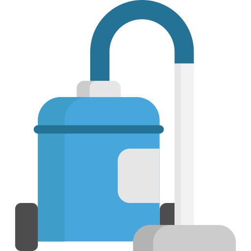

<div align="center">



<h1>Lazy Clean</h1>

<p>
  A lightweight Windows disk cleanup and maintenance tool written in C# WinForms, with no external dependencies.
</p>

<p>
  Scan temp folders, browser caches, duplicates, empty directories, and large files, then inspect every match before anything touches the Recycle Bin.<br />
  <em>You pick what goes. Nothing is deleted until you say so.</em>
</p>

<p>
  <a href="https://github.com/wildanzm/lazy-clean/actions/workflows/ci.yml"></a>
  <a href="https://github.com/wildanzm/lazy-clean/releases"></a>
  <a href="LICENSE"></a>
</p>

<p>
  
  
  
  
  
  
</p>

<p>
  <a href="#download">Download</a> &bull;
  <a href="#tech-stack">Tech Stack</a> &bull;
  <a href="#features">Features</a> &bull;
  <a href="#safety-checks">Safety</a> &bull;
  <a href="#building-and-testing">Build &amp; Test</a> &bull;
  <a href="#project-layout">Layout</a> &bull;
  <a href="#license">License</a>
</p>

</div>

## Download

Grab the standalone `LazyClean.exe` from [GitHub Releases](https://github.com/wildanzm/lazy-clean/releases). There is no installer; drop the `.exe` anywhere and run it.

If you want to verify the binary against the release `SHA256SUMS.txt` file:

```powershell
Get-FileHash .\LazyClean.exe -Algorithm SHA256
```

## Tech Stack

| Component | Used Here | Why |
| :--- | :--- | :--- |
| Language | C# 5 | Compiles cleanly with the `csc.exe` already shipped on Windows |
| Runtime | .NET Framework 4.5+ | Present on Windows without bundling an extra runtime |
| Desktop UI | WinForms (`DataGridView`, GDI+) | Virtual-mode file grid, split-pane category view, custom WCAG-checked colors |
| Shell Interop | `shell32.dll` (`P/Invoke`) | Moves files to the Recycle Bin (`SHFileOperation`) and empties it (`SHEmptyRecycleBin`) |
| Hashing | `System.Security.Cryptography.SHA256` | Two-pass duplicate matching (64 KB quick hash, then full file SHA-256) |
| Windows Tools | `dism.exe`, `compact.exe`, `powercfg.exe` | Component store cleanup, CompactOS compression, hibernation toggle |
| Build & CI | `csc.exe`, MSBuild 4.0, GitHub Actions | Local batch scripts, Visual Studio solution, automated tests, tagged releases |

## Features

- **Quick scan**: Checks User Temp, Windows Temp, Windows Update downloads, Delivery Optimization cache, browser caches (Chrome, Edge, Firefox), thumbnail and icon caches, crash dumps, Windows Error Reporting, system logs, and Prefetch.
- **Full drive scan**: Walks the drive in parallel for leftover extensions (`.tmp`, `.temp`, `.part`, `.crdownload`), empty directories, duplicate files (grouped by size and verified with SHA-256), and files over 500 MB (left unchecked so you inspect them first).
- **Safe deletion**: Sends checked items to the Recycle Bin by default, with an explicit checkbox if you want permanent deletion instead.
- **System tools**: Wrappers with live console output for `DISM` component store cleanup (`/AnalyzeComponentStore`, `/StartComponentCleanup`, `/ResetBase`), `CompactOS` status/enable/disable, emptying the Recycle Bin, turning off hibernation (`powercfg /h off`), and removing `C:\Windows.old` when it exists.
- **Fast review UI**: Category table on the left with tri-state checkboxes, item counts, sizes, and pending deletion totals; virtualized grid on the right with search-as-you-type, `All` / `Checked` / `Unchecked` filters, multi-column sorting, and `F5` refresh.

## Safety Checks

Scanning and deleting run through separate checks so a stale selection or bad path cannot slip through:

- **Installed apps and browser profiles stay untouched**: Software directories (`\Application\`, `\Current\`, `\app-`, `\Programs\`), updater backups (`.bak-*`, `.old`), binaries (`.exe`, `.dll`, `.sys`, `.node`, `.so`, `.pak`, `.dat`), and browser profile data (`User Data`, `Profiles`, `leveldb` `.log` files) are skipped during scans and refused if passed to delete.
- **OS and volume paths are blocked on every drive**: Drive roots (`C:\`, `C:`, `D:`), Windows folders (`System32`, `SysWOW64`, `WinSxS`, `Boot`, `servicing`), user libraries (`Documents`, `Desktop`, `Downloads`, `OneDrive`, etc.), and volume folders (`$Recycle.Bin`, `System Volume Information`, `Recovery`) are never deleted.
- **Path normalization and symlink guards**: Paths are canonicalized (stripping `\\?\` prefixes and resolving `..` segments) before checks run. Reparse points (symlinks, junctions, mount points) are ignored during traversal and rejected on delete, and folder targets must still be empty when deleted.
- **Explicit System32 paths and UAC**: `app.manifest` requests administrator elevation with high-DPI support, and external system utilities (`dism.exe`, `compact.exe`, `powercfg.exe`, `cmd.exe`) are launched directly from `%WINDIR%\System32`.

## Building and Testing

### Build with Windows' built-in compiler

You do not need Visual Studio or a separate .NET SDK installed. Run:

```bat
build.bat
```

This compiles `bin\LazyClean.exe` with `%WINDIR%\Microsoft.NET\Framework64\v4.0.30319\csc.exe`.

### Build with Visual Studio or MSBuild

Open `LazyClean.sln` in Visual Studio or run:

```bat
msbuild LazyClean.sln /p:Configuration=Release
```

### Run tests

`test.bat` builds both `LazyClean.exe` and the test runner, then runs all 68 automated checks (30 filesystem/safety checks and 38 WinForms UI checks):

```bat
test.bat
```

You can also invoke `LazyClean.Tests.exe` directly with:

| Flag | What it does |
| :--- | :--- |
| `--selftest` | Runs scan, duplicate hash, app-protection, and deletion checks in a temp directory |
| `--uismoke` | Exercises category navigation, virtual grid sorting, search, filters, and footer totals |
| `--scaninfo` | Prints a Quick Scan summary for the current machine without deleting anything |
| `--deepinfo` | Prints a Full Drive Scan summary for the current machine without deleting anything |

## Project Layout

```text
.
├── .github/workflows/
│   ├── ci.yml                      # CI build and test on push/PR
│   └── release.yml                 # Builds LazyClean.exe and SHA256SUMS.txt on v* tags
├── assets/
│   ├── app.ico                     # Application icon
│   └── icon.svg                    # Vector source for the icon
├── src/LazyClean/
│   ├── Core/
│   │   ├── Models.cs               # ScanItem, Category, ScanOptions, size formatting
│   │   ├── ScanEngine.cs           # Parallel scanner, SHA-256 dedupe, Recycle/permanent delete
│   │   ├── Targets.cs              # Scan locations, path normalization, protection rules
│   │   └── ViewLogic.cs            # Search, filter, and sort helpers
│   ├── Properties/
│   │   ├── app.manifest            # UAC requireAdministrator and DPI awareness
│   │   └── AssemblyInfo.cs         # Version metadata and InternalsVisibleTo
│   ├── UI/
│   │   ├── MainForm.cs             # Main window, category grid, virtual grid, system tools
│   │   └── Theme.cs                # Color tokens and fonts
│   ├── LazyClean.csproj            # MSBuild project (.NET Framework 4.5)
│   └── Program.cs                  # Entry point
├── tests/LazyClean.Tests/
│   ├── LazyClean.Tests.csproj      # Test project
│   └── SelfTest.cs                 # Self-tests, UI smoke runner, CLI diagnostics
├── build.bat                       # Standalone build using csc.exe
├── test.bat                        # Full build + test runner
├── LazyClean.sln                   # Visual Studio solution
├── LICENSE                         # MIT License
└── README.md
```

## Requirements

- Windows 7, 8, 10, or 11 (x86 or x64)
- .NET Framework 4.5 or newer (included with Windows)
- Administrator rights (prompted at startup so system temp folders and servicing tools can run)

## Contributing

Keep changes compatible with C# 5 so `build.bat` continues to compile on stock Windows machines without extra tooling, do not weaken path/ownership guards, and make sure `test.bat` passes before opening a pull request.

## License

MIT. See [LICENSE](LICENSE).
